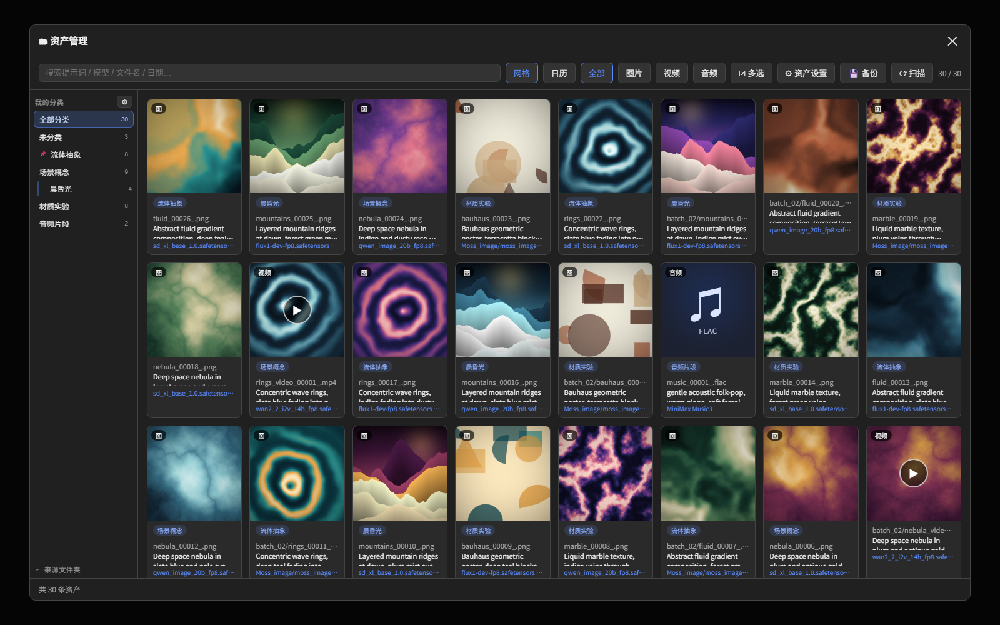
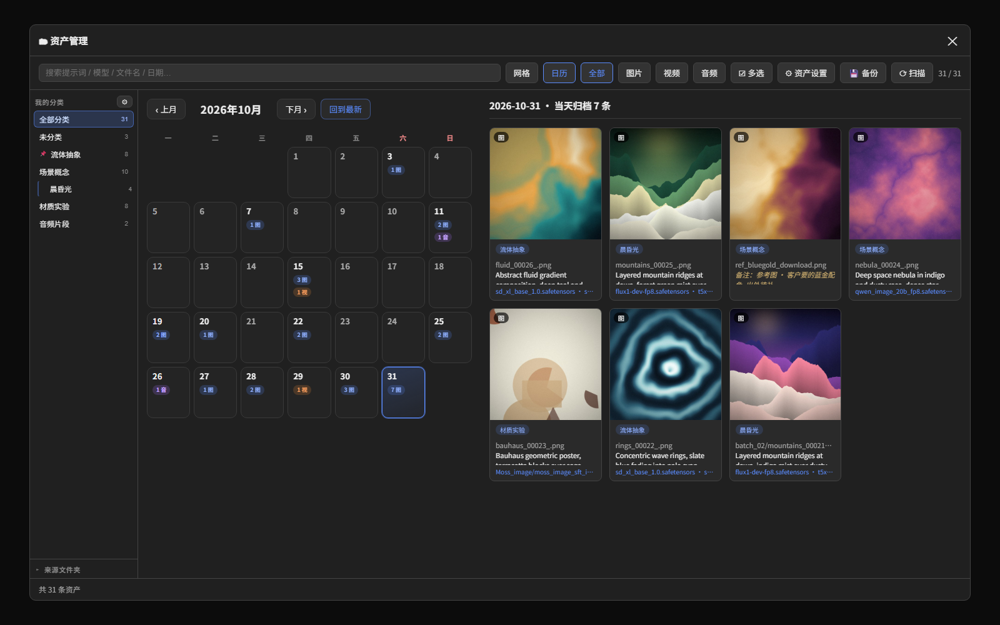
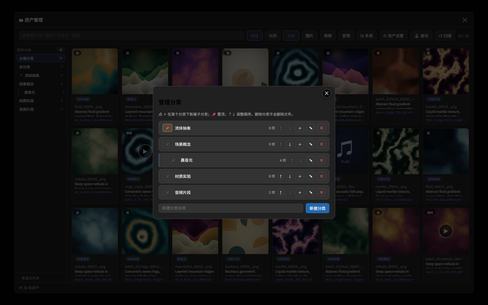
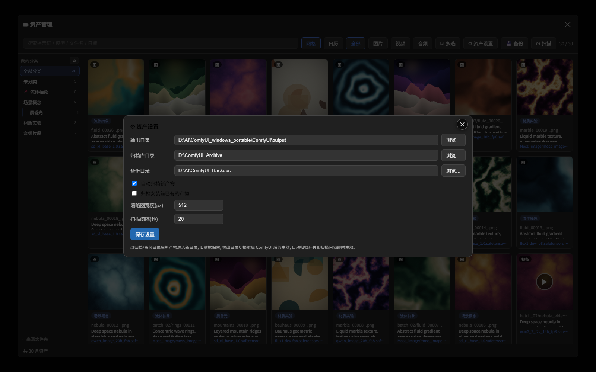
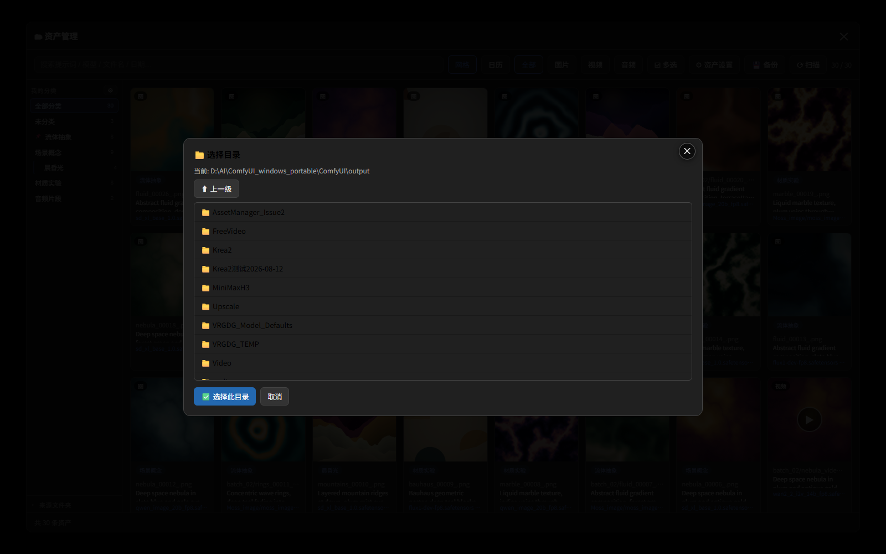
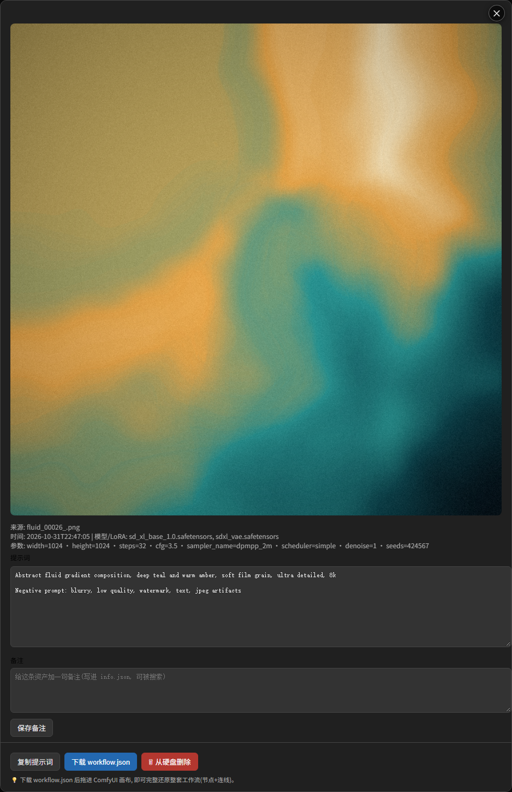

# ComfyUI-AssetManager

An in-panel **asset manager** for ComfyUI that auto-archives every image, video, and audio asset you generate — browse, search, preview, batch-delete, and one-click backup.

集成进 ComfyUI 网页的**资产管理面板**，自动归档生成的图片、视频和音频，支持浏览、搜索、预览、批量删除和一键备份。

## 功能说明 · What it does

- **Auto-archive** — a background thread watches the output directory and archives every image, video, and audio asset (on first run it can also import existing files), extracting **prompt / positive-negative / params / models & LoRA / full workflow** where available. It reads image/video container metadata and uses ComfyUI execution history as a fallback; audio metadata and duration are read with PyAV when available.<br>
  **自动归档** — 后台线程监视 output 目录并归档图片、视频和音频（可选择导入已有文件），尽可能提取**提示词 / 正负词 / 参数 / 模型与 LoRA / 完整工作流**。读取图片/视频容器元数据，并可回查 ComfyUI 执行记录；PyAV 可用时也会读取音频元数据和时长。
- **Dual views** — grid view + **calendar view** (grouped by date, with daily image/video/audio count badges; click a day to see that day's assets).<br>
  **双视图浏览** — 网格视图 + **日历视图**（按日期归档，每天显示图片/视频/音频数量徽标，点某天看当天产物）。
- **Search & filter** — full-text search by prompt/model/filename/date; filter by image/video/audio, by **source folder**, or by **your own category**.<br>
  **搜索与过滤** — 按提示词/模型/文件名/日期全文搜索，可按图片/视频/音频、**自建分类**（两级树）过滤，需要时还能按**来源文件夹**筛。
- **Category tree** — the sidebar is one folder-like tree: create categories, nest one level of sub-categories under them, and multi-select assets to move them in. Selecting a parent includes everything in its sub-categories. Categories can be **pinned to the top** and **reordered** with ↑↓ (per level, pinned ones stay above unpinned ones). Moving only rewrites archive metadata — original files and the archive layout are untouched, so it is easy to undo. A source-folder filter is also available, folded away at the bottom.<br>
  **分类树** — 左侧是一棵像文件夹的树：建分类、在分类下再挂一层子分类、多选产物移进去。选中父分类会把子分类里的产物一并算进来。分类可以**置顶**、用 ↑↓ **调整顺序**（按层级分组，置顶的始终排在未置顶之上）。移动只改归档元数据，不动原始文件、不动归档目录结构，改错了也能改回来；另外还有「来源文件夹」筛选，收在侧栏底部。
- **Preview & reproduce** — view full-size images, play videos and audio, copy prompt, download `workflow.json` (drag it back onto the canvas to restore the whole workflow).<br>
  **预览与复现** — 查看大图、播放视频和音频、复制提示词、下载 workflow.json（拖回画布还原整套工作流）。
- **Batch delete** — multi-select (Ctrl/Shift click or drag a box on empty space) and delete from disk in one go (archive copy + original output file); single delete too.<br>
  **批量删除** — 多选（Ctrl/Shift 点选，或在空白处拖框）后一次性从硬盘删除（归档副本 + output 原始文件），单个删除也可。
- **Live refresh** — the panel auto-syncs every 8 seconds; files manually copied into the output directory get archived, and manual deletions disappear automatically.<br>
  **实时刷新** — 面板每 8 秒自动同步，手动复制进输出目录的文件也会被归档、手动删除也会自动消失。
- **Content-fingerprint dedup** — every archived file is SHA-256 fingerprinted. When you **move or rename** a file in the output directory, the existing archive record is updated in place (source path, folder, category all preserved) instead of creating a second copy — so tidying up `output/` in Explorer no longer duplicates your library. Genuinely different files, and cases where **both** copies still exist, stay as separate records. Files over 64 MB skip the fingerprint and fall back to path-based tracking.<br>
  **内容指纹去重** — 每个归档文件都会算 SHA-256 指纹。在 output 里**移动或改名**文件时，原归档记录会被就地更新（来源路径、文件夹、分类全部保留），不会再归档出第二份——在资源管理器里整理 `output/` 不会再让资产库翻倍。内容真的不同、或者**两份都还在**的情况仍各自独立成记录。超过 64 MB 的文件跳过指纹，退化成按路径追踪。
- **Output directory switching** — change the output directory in settings; new assets save there instantly and it's **restored automatically after ComfyUI restarts**.<br>
  **输出目录切换** — 设置里改输出目录，新产物即时改存；**重启 ComfyUI 后自动恢复**。
- **Directory picker** — the output/archive/backup fields each have a "Browse…" button; pick a folder with the mouse, no manual path typing.<br>
  **目录点选** — 输出/归档/备份三个目录都带「浏览…」按钮，鼠标点选目录，无需手输路径。
- **One-click backup** — package "asset library + workflows + plugin config" into a zip.<br>
  **一键备份** — 把「资产库 + 工作流 + 插件配置」打包成 zip。

## 📸 Screenshots · 界面预览

> 截图取自演示归档（程序化生成的抽象画），只用于展示界面。

| Grid · 网格视图 | Calendar · 日历视图 |
|---|---|
|  |  |

| Category manager · 分类管理（置顶 / ↑↓ 排序） | Settings · 资产设置 |
|---|---|
|  |  |

| Browse · 目录点选 | Preview · 预览详情 |
|---|---|
|  |  |

## 📦 Installation · 安装

### Method 1: ComfyUI-Manager (recommended) · 方法一：ComfyUI-Manager（推荐）

Search for `AssetManager` in the Manager and install.<br>
在 Manager 里搜索 `AssetManager` 安装。

### Method 2: git clone · 方法二：git clone

```bash
cd ComfyUI/custom_nodes
git clone https://github.com/Wumihaze/ComfyUI-AssetManager.git
```

### Method 3: Manual download · 方法三：手动下载

Download the repo zip and extract it into `ComfyUI/custom_nodes/`, keeping the folder name `ComfyUI-AssetManager`.<br>
下载本仓库 zip，解压到 `ComfyUI/custom_nodes/` 下，目录名保持 `ComfyUI-AssetManager`。

> Dependencies: Python ≥ 3.9, `Pillow`, and PyAV (`av>=10.0.0`). Audio archiving and browser playback still work if PyAV is unavailable, but embedded audio metadata/duration and video thumbnails will be unavailable.<br>
> 依赖：Python ≥ 3.9、`Pillow` 和 PyAV（`av>=10.0.0`）。即使 PyAV 不可用，音频仍可归档和在浏览器播放，但无法读取音频容器元数据/时长或生成视频缩略图。

## 🚀 Usage · 使用

1. Start ComfyUI and click "**Asset Manager**" in the top menu bar to open the panel.<br>
   启动 ComfyUI，顶部菜单栏点「**资产管理**」打开面板。
2. Top toolbar: search box, grid/calendar toggle, all/image/video/audio filter, multi-select, backup, scan, settings.<br>
   顶部工具栏：搜索框、网格/日历切换、全部/图片/视频/音频过滤、多选、备份、扫描、资产设置。
3. Left sidebar: one **My categories** tree that takes the full height. Sub-categories are indented with a blue bar, and a parent's count includes its children. Click any row to filter the grid; click "All categories" to clear. **Source folders** sits collapsed at the bottom — click its header to expand (it remembers the active folder filter and shows it as a chip with a ✕ to clear).<br>
   左侧导航：一棵占满高度的 **我的分类** 树。子分类缩进并带蓝色竖条，父分类的条数包含其子分类。点任意一行右侧立刻只剩该范围，点「全部分类」恢复。**来源文件夹** 默认收在底部，点标题展开；已选的文件夹筛选会显示成小标签，点 ✕ 清除。
4. Multi-select: click ☑ Multi-select to enter it, or just **Ctrl/Cmd+click** / **Shift+click** on any asset — both switch to multi-select automatically. **Shift+click** selects the whole range from the last clicked asset, **Ctrl+click** toggles one, and **dragging on empty space** draws a box that selects everything it touches (hold Ctrl/Shift to add to the current selection instead of replacing it).<br>
   多选：点「☑ 多选」进入，也可以直接 **Ctrl/Cmd + 单击** 或 **Shift + 单击**，会自动切进多选。**Shift + 单击** 从上次点击的产物起整段连选，**Ctrl + 单击** 单个加/减，**在空白处拖拽** 拉框选中框到的全部（按住 Ctrl/Shift 是在现有选择上追加，不覆盖）。
5. Select assets → **Move to category** → a dialog lists your categories as radio rows (the one your assets already belong to is marked **current**), with a search box once there are many, a separate **Uncategorized (clear)** action at the bottom, and a create-and-move row. Moving rewrites only archive metadata.<br>
   勾选产物 →「**移到分类**」→ 弹窗把分类列成单选项（这些产物当前所属的分类会标 **当前**），分类多了会显示搜索框，底部单独一条 **未分类（移出分类）**，以及新建并移入。移动只改归档元数据。
6. **⚙ Manage categories** (the gear in the My categories header) → rename (✎), delete (✕), or create. On a top-level row, **＋** adds a sub-category right under it. **📌 pins a category to the top** (it shows a pin in the sidebar too) and **↑ ↓ reorder** it among its siblings; ordering is per level and per pin state, so a pinned category can't be pushed below an unpinned one by accident. Deleting a category never deletes files: its assets become uncategorized and its sub-categories move up one level.<br>
   分类区标题旁的 **⚙** → 重命名（✎）/ 删除（✕）/ 新建。一级分类行上的 **＋** 直接在它下面建子分类。**📌 置顶**（侧栏也会显示图钉），**↑ ↓ 调整顺序**；排序按「同一层 + 同一置顶状态」分组，所以置顶的分类不会被 ↑ 挤到未置顶区里去。删除分类**不会删除文件**：该分类下的产物变回「未分类」，它的子分类上移一层。
7. Click an asset → preview dialog: play audio/video, copy prompt / download workflow.json (drag back to canvas to reproduce) / delete from disk.<br>
   点产物 → 预览弹窗：播放音频/视频、复制提示词 / 下载 workflow.json（拖回画布复现）/ 从硬盘删除。

Audio files are auto-archived for `.wav`, `.mp3`, `.flac`, `.ogg`, `.opus`, `.m4a`, `.aac`, `.aiff`, `.aif`, and `.wma`. Playback uses the browser's native audio player, so actual playback depends on the browser's codec support. Audio metadata and duration are best-effort when PyAV is installed; if metadata is absent, ComfyUI execution history is queried for the prompt/workflow.<br>
音频自动归档支持 `.wav`、`.mp3`、`.flac`、`.ogg`、`.opus`、`.m4a`、`.aac`、`.aiff`、`.aif` 和 `.wma`。预览使用浏览器原生播放器，具体能否播放取决于浏览器支持的编码格式。安装 PyAV 时会尽力读取音频元数据和时长；文件没有提示词时会尝试从 ComfyUI 执行记录回查提示词/工作流。

## ⚙️ Configuration · 配置

A `config.json` is generated on your first settings save (template at [`config.example.json`](config.example.json)). Everything can also be changed in the panel's "⚙ Settings".<br>
首次保存设置时自动生成 `config.json`（模板见 [`config.example.json`](config.example.json)）。所有配置也可在面板「⚙ 资产设置」里直接改：

| Key · 键 | Description · 说明 |
|---|---|
| `output_dir` | Custom output directory (empty = ComfyUI default `output`) / 自定义输出目录（空 = 用 ComfyUI 默认 output） |
| `archive_dir` | Asset archive directory (empty = `<ComfyUI>/asset_archive`) / 资产归档库目录（空 = `<ComfyUI>/asset_archive`） |
| `backup_dir` | Backup zip directory (empty = `<ComfyUI>/asset_backups`) / 备份 zip 存放目录（空 = `<ComfyUI>/asset_backups`） |
| `auto_archive` | Auto-archive new assets (true/false) / 是否自动归档新产物（true/false） |
| `archive_existing` | On first run, also archive assets already in the output directory (false = only new assets after install) / 首次运行时是否也归档 output 里已有的历史产物（false = 只归档安装后的新产物） |
| `thumb_width` | Thumbnail width (px) / 缩略图宽度(px) |
| `interval_sec` | Archive scan interval (seconds) / 归档扫描间隔(秒) |

> ℹ️ 视频元数据/缩略图以及音频元数据读取使用 **PyAV** 在进程内完成，不会启动 ffmpeg/ffprobe 外部进程。
> 如果 PyAV 不可用，仍可归档和播放音频，但无法提取容器元数据/时长或生成视频缩略图。

### 📍 安装位置与盘符 · Install location

代码里**没有任何写死的盘符或绝对路径**，三个目录都在运行时确定：

- 插件位置：`BASE_DIR = dirname(__file__)` —— 装在哪个盘、哪个目录，就以哪里为准；
- 默认归档/备份：`<ComfyUI>/asset_archive`、`<ComfyUI>/asset_backups`（由插件目录 `../..` 推导）；
- 默认输出：`folder_paths.get_output_directory()`，即 ComfyUI 自己探测到的 output。

三个目录都可在面板「⚙ 资产设置」里改成任意位置（**由用户自主选择**）。若 `config.json` 里残留了
另一台机器或已移除盘符的路径，插件启动时会自动回退到上面的默认目录，并通过 `/asset/config` 的
`warnings` 字段说明原因——不会因为一个坏路径导致插件加载失败。

No drive letter or absolute path is hardcoded. `BASE_DIR` comes from `__file__`, the default archive/backup
directories are derived from the plugin location, and the output directory comes from `folder_paths`. All three
are user-configurable in settings; if a configured path is unavailable (e.g. the plugin was copied from another
machine), the plugin falls back to the defaults and reports the reason via `warnings` instead of failing to load.

## 📁 Directory structure · 归档目录结构

```
<archive dir>/
├─ categories.json              # your category tree / 自建分类树（支持一层子分类）
├─ archive_state.json           # scan state + content-fingerprint index / 扫描状态 + 内容指纹索引
└─ 2026-08-12/
   └─ 110358_ComfyUI_00016/
      ├─ ComfyUI_00016_.png       # original asset / 原产物
      ├─ info.json                # full info (prompt/params/models/workflow) / 完整信息(提示词/参数/模型/工作流)
      ├─ prompt.txt               # human-readable prompt / 人类可读提示词
      ├─ workflow.json            # drag back into ComfyUI to rerun / 拖回 ComfyUI 复跑
      └─ thumb.jpg                # thumbnail (first frame for videos) / 缩略图(视频取首帧)
```

`info.json` also carries `folder` (source subdirectory, auto-derived), `category` (id of your category, or `null`), and — for files under 64 MB — `content_hash` (SHA-256 of the file, used to detect moves/renames).
Older records without these fields are derived on the fly from `source_rel`, so no migration is needed.<br>
`info.json` 还记录 `folder`（来源子目录，自动派生）、`category`（自建分类 id，未分类为 `null`），以及 64 MB 以内文件的 `content_hash`（文件 SHA-256，用于识别移动/改名）。
老记录缺少这些字段时由 `source_rel` 即时派生，无需迁移。

`categories.json` keeps each category's `order` and `pinned` flag next to its `id` / `name` / `parent`. Files written by older versions have neither, so their order falls back to the position in the file — no migration needed.<br>
`categories.json` 里除了 `id` / `name` / `parent`，还记录 `order`（排序）和 `pinned`（是否置顶）。老版本写出的文件没有这两个字段，会按它在文件里的先后顺序显示，无需迁移。

## 📝 Notes · 说明

- Archiving is a **copy**; it doesn't affect ComfyUI previews. Files are only touched on disk when you delete them.<br>
  归档是**复制**，不影响 ComfyUI 预览；删除时才真正动硬盘。
- The archive directory can be migrated anytime — just change `archive_dir` in settings (old data stays where it was).<br>
  归档目录可随时迁移，只要在设置里改 `archive_dir` 即可（旧数据保留在原目录）。

### 🔍 为什么有的产物"未检测到提示词"？ · Troubleshooting prompt extraction

提示词优先从**文件内嵌元数据**读取（PNG `tEXt` / WebP `EXIF` / MP4-MKV ffmpeg tag）。
文件里没有元数据时，插件会再从 **ComfyUI 服务端执行记录**里按文件名找回当时那次执行的
提示词与工作流，所以正常情况下跑出来的图都能带上提示词。<br>
Prompts are read from the file's embedded metadata first; if absent, the plugin falls back to
ComfyUI's server-side execution history (matched by output filename), so generated images normally
carry their prompt.

预览弹窗会说明具体原因，常见三种：

| 提示 | 含义 | 怎么办 |
|---|---|---|
| ⚠ 文件本身不带 ComfyUI 元数据 | 图片不是 ComfyUI 直接存的：浏览器另存、手机/微信转存后拖进 output 目录；或 ComfyUI 启动时带了 `--disable-metadata`（隐私模式） | 用「保存图像 / SaveImage」节点跑出来的图会自动归档并带上提示词；若用了 `--disable-metadata`，去掉该参数即可 |
| 这次运行没有文本提示词节点 | 工作流里确实没有 CLIPTextEncode 一类节点（纯图像处理、证件照、放大等工作流） | 正常现象，无需处理 |
| 提示词由 ComfyUI 执行记录找回 | 文件本身没写元数据，但已从服务端历史补回 | 正常现象（说明该文件不带元数据，但提示词已找回） |

> 注：归档是复制原始文件，**不会**给你的图片补写元数据；找回的提示词只写进归档目录的
> `info.json` / `prompt.txt` / `workflow.json`。

## 📄 License

[MIT](LICENSE) © 2026 Wumihaze
